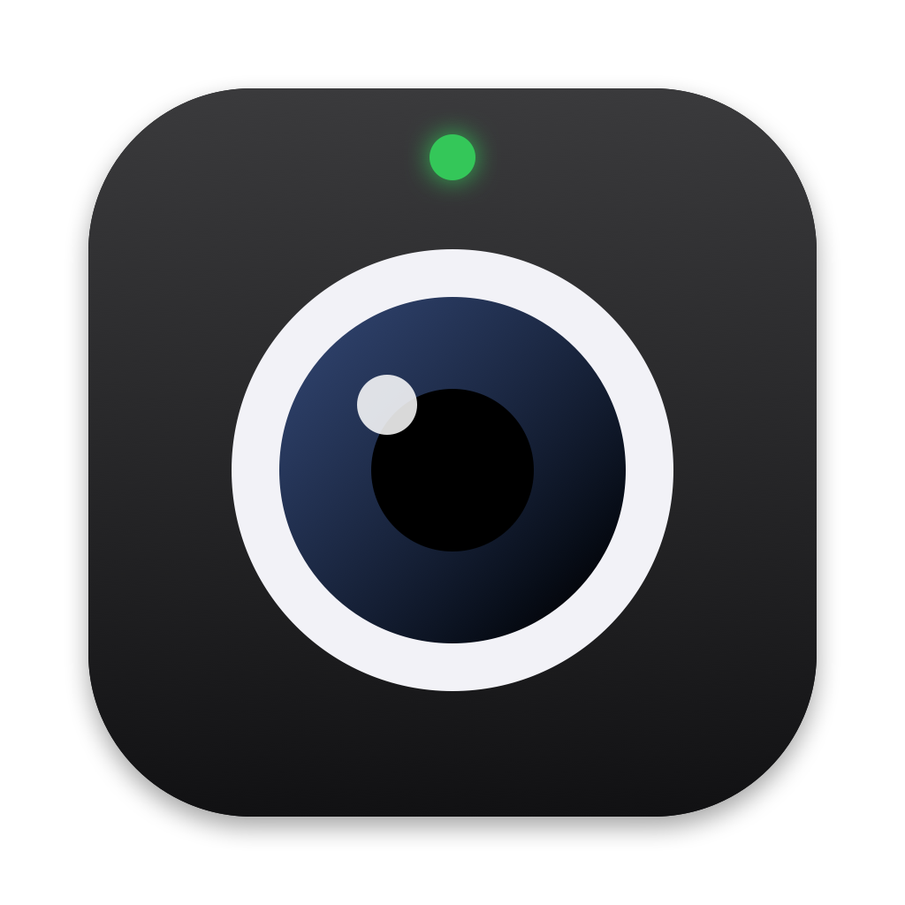

<p align="center">
  
</p>

<h1 align="center">Webcam</h1>

<p align="center">Your webcam, in a little floating window. That's it.</p>

---

A tiny macOS app that shows your camera in a borderless, always-on-top window in the
bottom-right corner of your screen. Handy for screen recordings, calls, or checking your hair.

It doesn't record, save, upload, or remember anything. No settings, no menu bar icon, no Dock icon.
One Swift file.

## Use it

| Do this               | To                    |
| --------------------- | --------------------- |
| Drag the video        | Move it               |
| Drag an edge          | Resize it (stays 16:9) |
| Press <kbd>Esc</kbd> or <kbd>Q</kbd> | Quit   |

The first time you open it, macOS asks for camera access. If you say no, it quits.

## Build it

You need Xcode (or the Command Line Tools) and [mise](https://mise.jdx.dev).

```sh
mise install       # swiftformat + swiftlint
mise run run       # build and open
mise run install   # copy to ~/Applications
```

Other tasks:

```sh
mise run build     # build/Webcam.app
mise run lint      # swiftformat --lint + swiftlint
mise run format    # swiftformat
mise run icon      # redraw Resources/AppIcon.icns from scripts/icon.swift
mise run clean     # delete build/
```

There's no Xcode project. `mise run build` calls `swiftc` on `Sources/main.swift`, puts the binary in an
`.app` bundle with `Resources/Info.plist` and the icon, and ad-hoc signs it.

## What's in here

```
Sources/main.swift   the whole app
Resources/           Info.plist and the icon
scripts/icon.swift   draws the icon with Core Graphics
scripts/icon.sh      turns it into an .icns
mise.toml            tools and tasks
```
